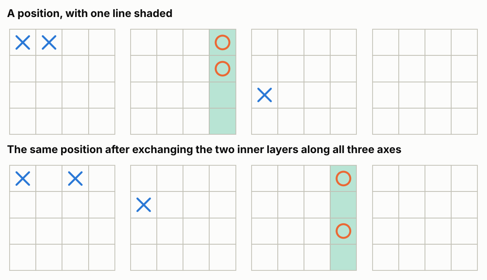
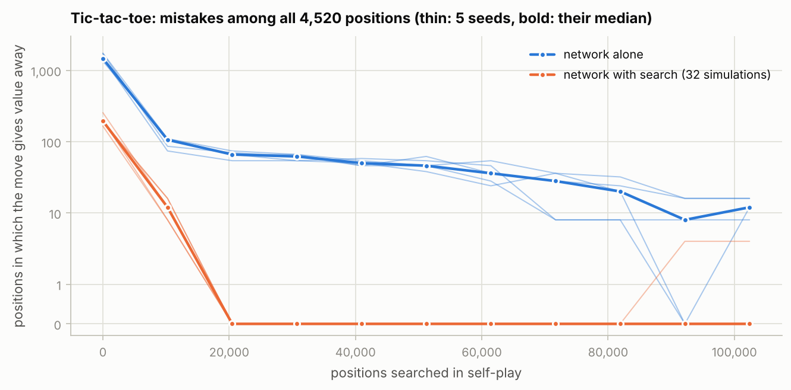
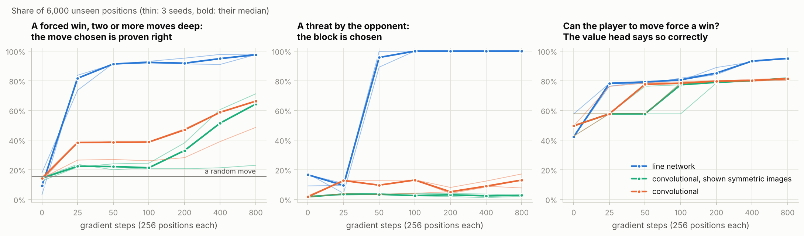

# Qubic_Zero

[](https://codespaces.new/shimmeringvoid/Qubic_Zero)
[](https://colab.research.google.com/github/shimmeringvoid/Qubic_Zero/blob/main/notebooks/01_the_game_and_exact_answers.ipynb)
[](https://mybinder.org/v2/gh/shimmeringvoid/Qubic_Zero/main?labpath=notebooks%2F01_the_game_and_exact_answers.ipynb)

Qubic is tic-tac-toe on a 4 × 4 × 4 board: 64 cells, 76 winning lines, at most
3<sup>64</sup> ≈ 3.4 × 10<sup>30</sup> ways to fill the board. It is a proven win for the first
player (Patashnik, 1980; solved again by Allis and Schoo, 1992). This project builds a player for it
in the style of AlphaZero: one small network with a policy head and a value head, a tree search
guided by it, trained by self-play alone. The goal is a player that wins every game it starts, and
a check of that claim by exact search and not only by sampled games.

It is the sequel to [MDP_Experiments](https://github.com/shimmeringvoid/MDP_Experiments), whose last
notebook ended where tables stop being an option.

**Where it stands.** Everything that can be done without a GPU is done: the game and the exact
tools, the whole learning pipeline proven on two small games, the choice of network, and the
measurements for a compute estimate. **No player has been trained on Qubic yet** beyond dry runs
of a few thousand games. Training on a GPU is the next step, and [notebook 4](notebooks/04_train_on_a_gpu.ipynb)
is ready for it.

## What came out of it so far

**One game, three boards.** Tic-tac-toe, its 3 × 3 × 3 cousin and Qubic run the same code, written
against a table of which cell lies on which line. The symmetries are found by search from that
table: 8, 48 and 192. Of Qubic's 192, only 48 are rotations and reflections of the cube. The others
exchange layers, so that cells which were neighbours no longer are. Which cells are neighbours is
not a fact about this game; only which cells share a line is.
([1](notebooks/01_the_game_and_exact_answers.ipynb))



**Exact answers to score against.** All 5,478 positions of tic-tac-toe are solved; in 4,520 of them
there is a move to make, and a player is scored by the number of those in which its move gives
value away (a random player: 1,894; a player that wins when it can and blocks when it must: 265).
Any position of the 3 × 3 × 3 game can be solved by search to the end. On Qubic, an exact search
finds the wins that can be forced by a chain of threats; in careless games, 84% of the positions
after 16 moves are such wins. ([1](notebooks/01_the_game_and_exact_answers.ipynb))

**The pipeline learns, on every seed.** On tic-tac-toe, five seeds, about a minute of training each
on one CPU thread: the players with their search (32 simulations) end with 0, 0, 0, 0 and 4
mistakes among the 4,520 positions, the networks alone with 16, 0, 16, 12 and 8. With 64
simulations none of the ten trained networks makes any. ([2](notebooks/02_small_games.ipynb))



**Right everywhere, or unbeatable?** The plan asked for no mistake in any position on every seed,
and that was not met to the letter: two of ten final networks err in one position each (up to
symmetry) at 32 simulations. Neither position is one its player can be led into. An exhaustive
check that tries every reply shows that all twenty players, the networks without search included,
cannot be beaten at tic-tac-toe from either side. On the 3 × 3 × 3 game, which the first player
wins, all ten trained players pass the check that the project is after: they **win every game they
start**, whatever the reply, with or without search. ([2](notebooks/02_small_games.ipynb))

**A network of lines.** The network is not convolutional. Cells send what they hold to the lines
they lie on, lines send what they see back to their cells, a few times over. All 192 symmetries are
built in (checked: the outputs for symmetric positions differ by rounding error). On 6,000 unseen
Qubic positions with exact answers, after 800 gradient steps, it picks a proven move in 97.1% to
97.9% of the forced wins and blocks in 100% of the positions that call for it. A convolutional
network with the same number of weights reaches 49% to 66% and 8% to 17%.
([3](notebooks/03_qubic_network_and_cost.ipynb))



**On Qubic itself, learning starts, attack first.** In dry runs of 102,400 positions (about 12,000
games, 12 minutes on one CPU thread) the line network with its search finds 96% to 97% of the
forced wins and beats the rule player in 86% to 93% of its games as first player. The convolutional
network, given the same, has not started (7% to 26%; 1% to 6%). But the line network blocks only
28% to 59% of the threats, and its self-play games shrink to 7.5 moves, where 7 is the shortest
game there is: the losing side does not defend. The same networks block 98% when they search with
64 simulations instead of 24, so the real run will not search with fewer simulations than the board
has cells. ([3](notebooks/03_qubic_network_and_cost.ipynb))

**The weak spot is the losing side.** In a game the first player wins, self-play soon has nothing
to teach the second player: all its moves lose. On the 3 × 3 × 3 game the networks alone, moving
second against the rule player, win anything from 40% to 82% of their games and vary by up to 31
percentage points within the second half of training. Letting a result count for a little less for
every move it is away (a discount) gives the loser a reason to hold out; it made the search player
a steadier defender there (94% against 87%) and more than halved the mistakes of the network alone
on tic-tac-toe (12 against 28). ([2](notebooks/02_small_games.ipynb))

## What has not been done or tested

* **No training run on Qubic** beyond the dry runs, and **nothing has run on a GPU**. Notebook 4 was
  only executed in its CPU mode with tiny settings. Its first minutes on a GPU are a test.
* **No compute estimate for a GPU.** The cost is measured in calls of the network, and on two CPU
  cores a run of 5 million positions would take about 23 hours. The same speed test on the GPU
  (two minutes, in notebook 4) gives the real number. How many positions Qubic needs is not known.
* **The goal itself.** Whether a trained player wins every game of Qubic it starts, how far the
  exact check gets, and what exact search has to add at play time, are the later stages.
* The size of the line network was not varied. The interface (a 3D board in the browser) is not
  built; there is a game in the terminal.
* The tests run with Python 3.10 and 3.13 in the test workflow; everything else here was run with
  Python 3.13 only. The Codespaces, Colab and Binder set-ups are written as for MDP_Experiments
  but could not be tried before the repository was online.
* **The conda environment has only run on CPUs.** The test workflow creates it on Linux, on macOS
  (Apple silicon) and on Windows and runs the tests in it, and they pass on all three (Python
  3.13, NumPy 2.5, PyTorch 2.14, all from conda-forge). The training command and the four
  notebooks were run in it on Linux only; the first three notebooks print the same sentences as
  are stored here. For machines with an NVIDIA card, only conda's choice of packages was looked
  at, with the driver given to it by hand. Apple's GPUs (`--device mps`) are untried. Nor was the
  environment tried with Anaconda's own channel (`defaults`) configured, as Anaconda and Miniconda
  installs have it: conda 26.10 then consults that channel too, after conda-forge, in spite of the
  `nodefaults` line.

## The notebooks

| | Notebook | Contents |
|---|---|---|
| 1 | [The game and its exact answers](notebooks/01_the_game_and_exact_answers.ipynb) | Boards, lines and symmetries; the two reference players; the exact tools and the numbers a learner is scored against |
| 2 | [The whole pipeline on two small games](notebooks/02_small_games.ipynb) | Tic-tac-toe on all positions and the 3 × 3 × 3 game, five seeds each; what the search adds; the exhaustive check |
| 3 | [Qubic: which network, and what will it cost?](notebooks/03_qubic_network_and_cost.ipynb) | The line network against a convolutional one, on exact answers and in dry runs; the cost of a run |
| 4 | [Training on a GPU](notebooks/04_train_on_a_gpu.ipynb) | The notebook to run: speed test, training with checkpoints on Google Drive, progress, and a zip of logs and weights |

They are stored with their outputs, so they can be read here without running anything. The
sentences that quote numbers are produced by the code. Notebooks 2 and 3 train nothing: they read
the logs and weights under `results/`, which three scripts in `tools/` wrote.

## Running it

### In the browser, with nothing to install

* **GitHub Codespaces** (the first badge) creates a machine with the library, Jupyter and PyTorch.
* **Google Colab.** Every notebook has an *Open in Colab* badge under its title; its first code
  cell fetches this repository.
* **Binder** (the third badge) installs the library without PyTorch, so it runs notebook 1.

### On your own machine

With pip, into a Python environment of your choice:

```bash
git clone https://github.com/shimmeringvoid/Qubic_Zero.git && cd Qubic_Zero
pip install -e ".[train,notebooks,dev]"   # the library, PyTorch, Jupyter, pytest
pytest                                     # about a minute
jupyter lab notebooks
```

Or with conda, which brings its own Python. [`environment.yml`](environment.yml) lists the same
packages, all from conda-forge:

```bash
git clone https://github.com/shimmeringvoid/Qubic_Zero.git && cd Qubic_Zero
conda env create -f environment.yml        # an environment named qubic-zero; about half a gigabyte to download
conda activate qubic-zero
pytest
jupyter lab notebooks
```

**With an NVIDIA card**, conda installs a PyTorch built for CUDA (2.5 to 4 GB to download) when it
finds a driver that is recent enough for the newest PyTorch, and otherwise one for the CPU, without
a warning. This tells which it was:

```bash
python -c "import torch; print(torch.__version__, torch.cuda.is_available())"
```

If the answer is `False` on a machine with such a card, ask for the CUDA build outright. conda then
installs a PyTorch that the driver supports, an older one if need be, or says what is missing
(`conda info` lists the driver it found as `__cuda`):

```bash
conda install -n qubic-zero -c conda-forge --override-channels pytorch-gpu
```

`make results` trains everything under `results/` again (about an hour on two cores) and
`make notebooks` runs the four notebooks from clean kernels (a few minutes). Training is not
reproducible to the last bit across machines and PyTorch versions, so the numbers will differ a
little. The stored outputs were produced with Python 3.13, NumPy 2.5 and PyTorch 2.15.

## Training on Qubic

A run is a folder: settings, a log with one line of JSON per report, snapshots of the weights, and
a checkpoint. Starting a run and continuing it are the same command:

```bash
python -m qubic_zero.benchmark                                   # two minutes: speed, and hours for runs of 1, 5 and 20 million positions
python -m qubic_zero.train --run-dir runs/qubic-seed-0 --seed 0 --hours 11
```

It checkpoints every ten minutes and when it stops, and a continued run ends exactly as an
uninterrupted one would (the tests check this, weight for weight). It uses a CUDA GPU when there is
one and the CPU otherwise, and says which in its first lines. When it stops it also zips the
settings, the log and the weights next to the folder (`runs/qubic-seed-0.zip`): the file to keep or
to send. On Colab, [notebook 4](notebooks/04_train_on_a_gpu.ipynb) wraps the same calls and keeps
the folder on Google Drive.

## Playing

Playing needs NumPy only. There is no Qubic player worth playing yet, but the small ones are here:

```bash
python -m qubic_zero.play results/3x3x3-discount-0.95/seed-0/weights/latest.npz --second
```

## The library

```python
import numpy as np
import qubic_zero as qz

game = qz.qubic()                                   # also qz.tictactoe(), qz.cube3()
print(game, len(game.symmetries))                   # 64 cells, 76 lines of 4; 192 symmetries
result = qz.play_games(game, qz.rule_player, qz.random_player, 1000, np.random.default_rng(0))
board = game.play(game.empty(), 0)
print(qz.threat_search(game, board).win)            # a win by force for the player to move?
```

| Module | Contents |
|---|---|
| `games` | A game as a table of cells and lines; the rules; symmetries found by search |
| `players` | The random player and the rule player; games between any two players, played side by side |
| `exact` | Every position of a tiny game; the value of one position by search; wins by threats; the exhaustive "wins every game" check |
| `net` | The line network, a convolutional control, weights as plain arrays, a NumPy forward pass |
| `search` | AlphaZero's tree search, once for one position in plain Python and once for thousands as arrays |
| `train` | Self-play, memory, learning, log, checkpoints; `python -m qubic_zero.train` |
| `agents` | Players made from a network: alone, with search, with the threat search in front |
| `evaluate` | Scores against exact answers, the tactics suite, matches |
| `benchmark` | Speed of this machine and the length of a run |
| `play` | The trained player in NumPy alone, and a game in the terminal |
| `plotting` | Figure style and drawings of boards |

## Layout

```
notebooks/     the four notebooks, with outputs
src/qubic_zero the library
tests/         its tests
tools/         the scripts that wrote results/
results/       logs and final weights of the stored runs
figures/       figures written by the notebooks
.devcontainer/ the environment that GitHub Codespaces builds
binder/        what Binder installs
```

## Where next

3. **Training** on a GPU, several seeds as the budget allows, scored often against exact answers.
4. **Strength and proof.** Against the random and rule players; as first player against a strong
   search opponent; then the exhaustive check, with the threat search closing branches, and a plain
   report of how far it got. Where it finds holes, exact search at play time has to fill them.
5. **A page to play on**: a 3D board in the browser.
6. The write-up.

## Licence

MIT, see [LICENSE](LICENSE).

**References.** O. Patashnik, "Qubic: 4 × 4 × 4 tic-tac-toe", *Mathematics Magazine* 53, 1980.
L. V. Allis and P. N. A. Schoo, "Qubic solved again", in *Heuristic Programming in Artificial
Intelligence 3*, 1992. L. V. Allis, *Searching for Solutions in Games and Artificial Intelligence*,
PhD thesis, University of Limburg, 1994. D. Silver et al., "A general reinforcement learning
algorithm that masters chess, shogi, and Go through self-play", *Science* 362, 2018.
